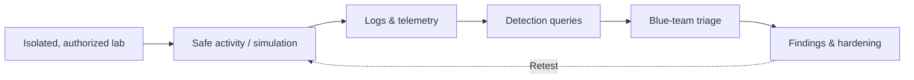

# 🔴🔵 Blue–Red Cybersecurity Lab

A hands-on **authorized training lab** for understanding how security observations turn into defensive investigations. This portfolio project documents proposed exercises using tools such as Nmap, Burp Suite, Cowrie, Splunk, and Gophish. **Tool names describe a learning roadmap, not verified deployments or completed experiments.**

## 🧭 Lab workflow

The red-team role is to generate **benign, permitted test signals**. The blue-team role is to collect evidence, assess alerts, and recommend mitigations.

## 🎯 Learning objectives

- Define scope, written permission, and safe lab boundaries.
- Document what telemetry a defensive analyst needs to investigate an event.
- Develop detection hypotheses and validate them against synthetic or lab-generated data.
- Explain false positives, visibility gaps, and remediation priorities.

## 🧪 Suggested exercises

| Exercise | Controlled activity | Blue-team evidence |
| --- | --- | --- |
| Network discovery | Identify a single owned lab host with a narrowly scoped, rate-limited check | Firewall logs, host inventory, authorized scan record |
| Web request review | Inspect a deliberately vulnerable local training application using passive proxy observation | HTTP access logs, request metadata, secure configuration notes |
| SSH honeypot observation | Deploy Cowrie only in a segregated lab with appropriate access controls | Redacted connection attempts, timestamped event review |
| Windows sign-in analysis | Make a few expected test-account sign-ins on a personal VM | Windows 4624/4625 events, Splunk investigation notes |
| Phishing awareness | Use fictional email samples **without delivery to real recipients** | Training indicators and reporting workflow |

See [Lab validation playbook](docs/lab-validation-playbook.md) for a reproducible evidence template.

## 🔐 Rules of engagement

Only use systems and accounts you own or are explicitly authorized to test. Never collect real passwords, target third parties, or send unsolicited phishing messages. Keep honeypots segmented, avoid storing personal data, and redact screenshots before publishing.

## 📋 Project status

**Documentation and lab plan:** available. **Execution and outcomes:** not yet independently verified. Add dated, sanitized evidence before claiming a detection succeeded or a tool was deployed.
